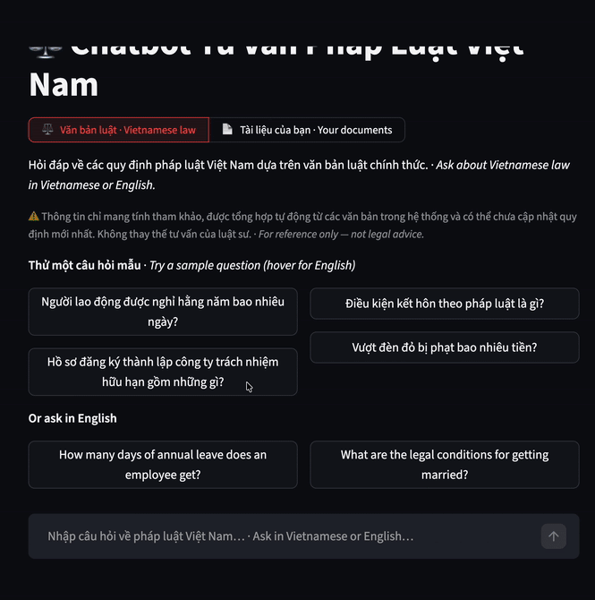
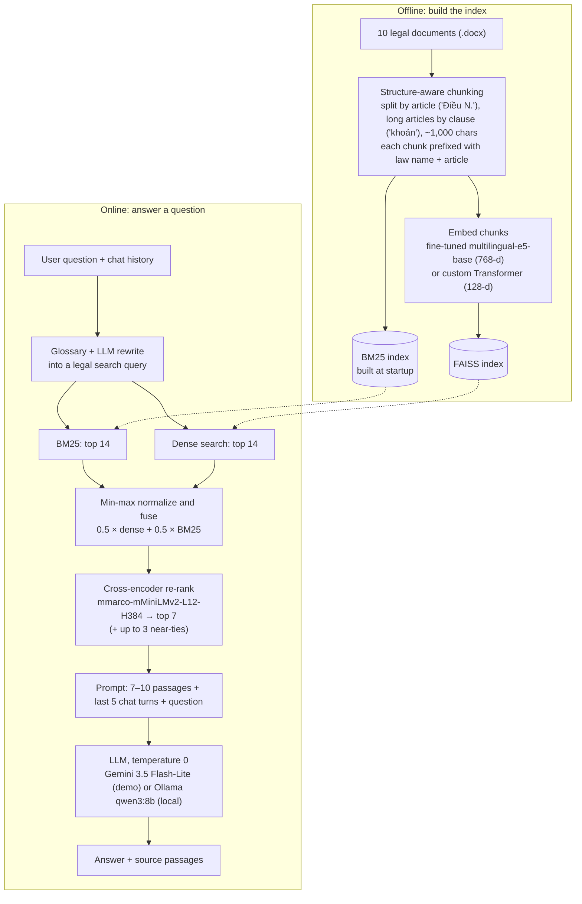
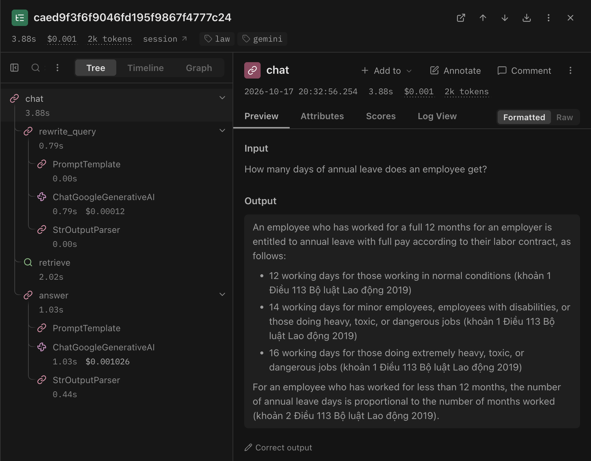

# Vietnamese Legal RAG Chatbot

**A chatbot that answers questions about 10 core Vietnamese laws and decrees, asked in Vietnamese or English, grounded in the official Vietnamese legal text and citing the law and article. It is built for citizens, HR staff, small businesses and foreign investors who need a quick legal lookup without reading the whole code.**

[](https://vietnamese-rag-chatbot-jemrcpipbmxd5bdugx5z2l.streamlit.app)
[](https://github.com/Leanhoangy/vietnamese-rag-chatbot/actions/workflows/tests.yml)
[](https://huggingface.co/Hoangy2005/vietnamese-legal-embedder)
[](https://www.python.org)
[](https://pytorch.org)
[](https://www.langchain.com)
[](LICENSE)

**▶ Live demo: [vietnamese-rag-chatbot-jemrcpipbmxd5bdugx5z2l.streamlit.app](https://vietnamese-rag-chatbot-jemrcpipbmxd5bdugx5z2l.streamlit.app)**
<br><sub>Hosted on the free tier: the app sleeps when idle, so the first load can take a few minutes while it wakes up and downloads the model.</sub>

<p align="center">
  
</p>
<p align="center"><sub>Asking about Vietnamese law in English, opening the cited articles, then switching to <b>Your documents</b> and asking the sample handbook.</sub></p>

## Key features

- **Query rewriting + hybrid retrieval with re-ranking.** A small glossary first maps everyday terms to the wording used in the law (for example "đèn đỏ" → "đèn tín hiệu giao thông"), then the LLM rewrites the question into a Vietnamese legal search query. This also covers follow-ups that depend on the chat history, questions asked in English and Vietnamese typed without diacritics; answers come back in the user's language. BM25 keyword search and FAISS dense search then run in parallel, their scores are fused 50/50, and a multilingual cross-encoder picks the top 7 passages, extended to up to 10 when more provisions score almost as high (questions such as "running a red light" span one article per vehicle type). Exact references (article numbers, fine amounts) and everyday wording can both match.
- **Two domain-trained embedding models.** `multilingual-e5-base` (278M parameters) is fine-tuned with triplet loss on 3,642 legal triplets with FAISS-mined hard negatives and [published on Hugging Face](https://huggingface.co/Hoangy2005/vietnamese-legal-embedder). Alongside it is a 738,560-parameter Transformer encoder built from scratch in PyTorch, with its own tokenizer, architecture and training loop.
- **Answers tied to sources.** Every chunk is stamped with its law name and article number, and the LLM (temperature 0) is prompted to answer only from the retrieved passages and cite them that way. Answers can expand to show the source passages. The last 5 chat turns go into the prompt, so follow-up questions work. When no passage is relevant enough (cooking, gold prices, laws outside the corpus), the bot declines without calling the LLM instead of guessing, and greetings get an instant reply.
- **Chat with your own documents.** A second mode takes up to 3 PDF, DOCX, TXT or Markdown files (10 MB each), indexes them in memory for that browser session only, and answers from them with the same hybrid retrieval and re-ranking, citing the file name and section. A Vietnamese question about an English file works too, and scanned PDFs without a text layer get a clear error instead of an empty answer. A fictional employee handbook ([`samples/`](samples/)) lets visitors try it in one click.
- **Streaming answers.** Retrieval runs first, then the answer streams token by token, so the reply starts appearing instead of arriving all at once. An error mid-stream (for example a rate limit) ends the reply with a readable message instead of breaking the page.
- **Optional monitoring with [Langfuse](https://langfuse.com).** When Langfuse keys are set, every question becomes a trace with the query rewrite, the retrieved passages and the answer generation (tokens, latency), tagged with the LLM provider, the search query, the top re-rank score and whether the bot declined. Without keys it is switched off. Questions about uploaded files are not traced unless you opt in. ([Example trace](docs/langfuse-trace.png))
- **Evaluation pipeline.** It measures retrieval (NDCG, MRR, Recall, Precision), runs RAGAS (faithfulness, answer relevancy, context precision and recall) and scores semantic similarity against reference answers.
- **Cloud or fully local.** The repo includes a Streamlit chat UI, a FastAPI endpoint and a prebuilt FAISS index, and the fine-tuned model downloads from Hugging Face Hub on first start. One setting switches the LLM between Gemini (hosted demo) and any Ollama model running on your own machine, so documents and questions never leave it. The public demo protects its API quota with per-session and daily question limits and caches answers to repeated opening questions (never answers about uploaded files).
- **10 legal documents covered, kept current.** Civil Code 2015, Labor Code 2019, Land Law 2024, Law on Enterprises 2020, Law on Marriage and Family 2014, Road Law 2024, the 2025 law amending the Penal Code, and the traffic-fine decrees 168/2024 (in force since 1 January 2025), 238/2026 (its amendments) and 100/2019 (for earlier violations). The official texts of the two newest decrees are only published as scanned PDFs, so their Word texts were cross-checked against the scans with OCR: every monetary amount matches (473 in Decree 168, 23 in Decree 238).

## Architecture



More detail (in Vietnamese) is in [ARCHITECTURE.md](ARCHITECTURE.md).

## Evaluation results

**Golden-set check: 25/25.** 25 common questions have hand-checked reference answers taken from the legal text ([`evaluation/golden_set.json`](evaluation/golden_set.json)). Each answer must contain the key facts (exact fine range, number of days, age...), cite the right article and law, and for traffic questions must not quote the superseded Decree 100/2019 amounts. With Gemini 3.5 Flash-Lite answering, all 25 pass ([`evaluation/results_golden.json`](evaluation/results_golden.json), 17 Oct 2026):

| Domain | Questions | Passed | Examples |
|:--|:--:|:--:|:--|
| Traffic fines (Decrees 168/2024, 238/2026) | 10 | 10 | red light, drink-driving, helmet, speeding, phone use, wrong-way driving, licence point deductions, child-seat rule amended in 2026 |
| Labor Code 2019 | 5 | 5 | annual leave, probation, resignation notice, overtime cap, maternity leave |
| Law on Enterprises 2020 | 3 | 3 | LLC member limit, minimum shareholders, registration deadline |
| Civil Code 2015 | 3 | 3 | contract dispute limitation period, age of majority, inheritance claims |
| Law on Marriage and Family 2014 | 2 | 2 | marriage age, custody of children under 36 months |
| Asked in English | 2 | 2 | annual leave, minimum marriage age |

Earlier runs of the traffic questions exposed three real bugs, fixed before this run (see [ARCHITECTURE.md](ARCHITECTURE.md#6-lỗi-đã-gặp-và-cách-sửa)). A golden set checks that known answers stay correct; it is not a benchmark of unseen questions.

**Earlier automatic metrics** — full pipeline (hybrid retrieval, k = 7) on questions from `data/qa/test_set.json`. All scores are averages between 0 and 1; higher is better. These runs used Groq-hosted Llama models, before the project switched to Gemini / Ollama.
<!-- TODO: re-run the evaluation with the current LLM setup. -->

| Metric | Fine-tuned E5 (deployed) | Custom Transformer |
|:--|:--:|:--:|
| **Retrieval** | | |
| NDCG@7 | 0.9899 | 0.9937 |
| MRR@10 | 0.9914 | 1.0000 |
| Recall@7 | 1.0000 | 1.0000 |
| Precision@7 | 0.9511 | 0.9821 |
| **Generation (RAGAS)** | | |
| Faithfulness | 0.8854 | 0.7738 |
| Answer relevancy | 0.9104 | 0.8654 |
| Context precision | 0.6820 | 0.6160 |
| Context recall | 0.9000 | 0.7500 |
| **Answer vs. reference** | | |
| Semantic similarity | 0.8049 | 0.7428 |

<!-- TODO: no raw evaluation output (evaluation_results.json) is committed. These values come from README.md at commit e13f29b. An earlier run (2026-05-18) gave fine-tuned E5 NDCG@7 0.9950 / MRR@10 1.0000 / Precision@7 0.9857. Re-run and commit the output, then update this table. -->

**How to read these numbers**

- **Sample size and models.** Per the scripts in [`evaluation/`](evaluation/), fine-tuned E5 is scored on the first 150 of the 306 test questions (RAGAS on the first 50), with answers generated by `llama-3.1-8b-instant`. The Custom Transformer is scored on the first 10 questions, with answers from Llama 3.3 70B. RAGAS uses `llama-3.1-8b-instant` as the judge.
- **Relevance labels are heuristic.** A retrieved passage counts as relevant when it shares enough words with the LLM-generated reference answer. Only the 7 retrieved passages are scored, so Recall@7 is 1.0 whenever any one of them matches. Treat the retrieval scores as sanity checks, not as a benchmark.
- **Train/test overlap.** 119 of the first 150 test questions also appear as anchors in the current training triplets (`data/triplets/legal_triplets_dataset`), so scores on truly unseen questions should be expected to be lower. <!-- TODO: rebuild the training triplets without test_set.json questions and re-evaluate. -->
- **Checkpoint.** The Custom Transformer scores were recorded before its current 738,560-parameter checkpoint was trained.

## Tech stack

| Layer | Tools |
|:--|:--|
| LLM | Gemini `gemini-3.5-flash-lite` via Google AI Studio (hosted demo), or any Ollama model locally (default `qwen3:8b`) |
| Orchestration | LangChain (prompt → model → output parser) |
| Embeddings | sentence-transformers, fine-tuned `intfloat/multilingual-e5-base`, custom PyTorch Transformer encoder |
| Retrieval | FAISS (`faiss-cpu`), `rank-bm25`, cross-encoder `cross-encoder/mmarco-mMiniLMv2-L12-H384-v1` |
| Training | PyTorch, sentence-transformers `TripletLoss`, Google Colab GPU ([`training/train_colab.ipynb`](training/train_colab.ipynb)) |
| Evaluation | RAGAS, custom NDCG / MRR / Recall / Precision, semantic similarity (`paraphrase-multilingual-MiniLM-L12-v2`) |
| Document upload | `pypdf`, `docx2txt`, in-memory FAISS + BM25 index per session |
| Serving | Streamlit (chat UI, streaming), FastAPI (REST), Streamlit Community Cloud, Hugging Face Hub (model hosting) |
| Monitoring | Langfuse (optional, via its LangChain callback) |

## Run locally

**Prerequisites:** Python 3.11, about 1.1 GB of free disk space for the fine-tuned embedder, and one LLM option:

- **Cloud:** a free [Google AI Studio API key](https://aistudio.google.com/apikey), or
- **Local:** [Ollama](https://ollama.com) with a model pulled, e.g. `ollama pull qwen3:8b` (about 5.2 GB).

**1. Install**

```bash
git clone https://github.com/Leanhoangy/vietnamese-rag-chatbot.git
cd vietnamese-rag-chatbot
python3.11 -m venv .venv
source .venv/bin/activate        # Windows: .venv\Scripts\activate
pip install -r requirements.txt
```

**2. Configure.** Copy the template with `cp .env.example .env`, then fill in your key. `.env` is gitignored, so it never gets committed. For a fully local setup, set `LLM_PROVIDER=ollama` and leave out the Google key. The template contains:

```dotenv
# LLM provider: "gemini" or "ollama".
# If unset: gemini when GOOGLE_API_KEY is present, otherwise ollama.
LLM_PROVIDER=gemini
GOOGLE_API_KEY=your_google_ai_studio_key_here

# Optional: override the model (defaults: gemini-3.5-flash-lite / qwen3:8b)
# LLM_MODEL=gemini-3.5-flash-lite
# OLLAMA_BASE_URL=http://localhost:11434

# Optional: use fine-tuned E5 even if a locally trained custom Transformer exists
# USE_FINETUNED=true

# Optional: LLM query rewriting before retrieval: auto (default) | true | false
# auto = always with Gemini; with Ollama only for follow-up questions (the glossary covers the rest).
# Each rewrite is one extra LLM call.
# QUERY_REWRITE=auto

# Optional: demo protection (0 = unlimited)
# DEMO_SESSION_LIMIT=20     # questions per browser session
# DEMO_DAILY_LIMIT=200      # LLM-backed questions per day for the whole app

# Optional: decline a question when the best passage's cross-encoder score is below this
# MIN_RELEVANCE_SCORE=-4.0

# Optional ("Your documents" mode): relevance gate for uploaded files — looser than the legal corpus,
# because the cross-encoder scores cross-language matches (Vietnamese question, English file) lower
# USER_DOCS_MIN_RELEVANCE_SCORE=-6.0

# Optional: Langfuse tracing (https://langfuse.com) — off unless both keys are set
# LANGFUSE_PUBLIC_KEY=pk-lf-...
# LANGFUSE_SECRET_KEY=sk-lf-...
# LANGFUSE_BASE_URL=https://cloud.langfuse.com    # US region: https://us.cloud.langfuse.com
# LANGFUSE_TRACE_UPLOADS=false                     # also trace "Your documents" questions (sends file excerpts)
```

The template also has two settings for evaluation (`EVAL_JUDGE_PROVIDER`, `EVAL_JUDGE_MODEL`), used further below.

**3. Start the app**

```bash
streamlit run src/app.py         # → http://localhost:8501
```

The switch at the top of the page picks between the legal corpus and **Your documents**; in the second mode, upload files or click **Use sample**. The first start downloads the fine-tuned embedder from Hugging Face Hub, along with the cross-encoder. Later starts use the local copy. Running fully local with `qwen3:8b` on an M1 Pro with 16 GB RAM, a test question took about 24 seconds end to end. With Ollama, the LLM query rewrite runs only for follow-up questions and took 0.6–8 seconds in testing.

**4. Optional: REST API**

```bash
uvicorn src.api:app --reload     # interactive docs at http://localhost:8000/docs

curl -X POST http://localhost:8000/chat \
  -H "Content-Type: application/json" \
  -d '{"message": "Còn người đi bộ thì sao?",
       "history": [{"role": "user", "content": "Vượt đèn đỏ bị phạt bao nhiêu tiền?"},
                   {"role": "assistant", "content": "..."}]}'
```

The response contains `reply`, the rewritten `search_query`, `sources` (law, article, excerpt) and `notes` (for example, a warning when a cited decree has been superseded). The API returns 503 when the LLM provider is overloaded and 422 for malformed requests.

**5. Optional: unit tests**

```bash
pip install -r requirements-dev.txt   # light: no torch or model downloads needed
pytest -q
```

The same tests run on every push via GitHub Actions. They cover the glossary, the clause-aware chunker, canned replies, the golden-set checker, file upload parsing (including scanned-PDF detection) and the tracing switch.

**6. Optional: monitoring with Langfuse**

Create a free project at [cloud.langfuse.com](https://cloud.langfuse.com), then put its keys in `.env` (locally) or in the app's Secrets (Streamlit Cloud): `LANGFUSE_PUBLIC_KEY`, `LANGFUSE_SECRET_KEY` and, for the US region, `LANGFUSE_BASE_URL`. Restart the app. Each question then shows up under **Traces** with its steps (`rewrite_query`, `retrieve`, `answer`), the browser session and the metadata above. The FastAPI endpoint is traced the same way.

<p align="center">
  
</p>
<p align="center"><sub>A trace from the live demo: an English question is rewritten into a Vietnamese legal query (0.79 s), passages are retrieved and re-ranked (2.02 s), and Gemini answers in English with Vietnamese citations (1.03 s).</sub></p>

<details>
<summary><b>Retrain, rebuild the index, evaluate</b></summary>

```bash
python training/train_finetuned.py   # fine-tune multilingual-e5-base (GPU recommended, or use training/train_colab.ipynb)
python training/train_custom.py      # train the from-scratch Transformer (runs on CPU)

# The FAISS index must be built with the same model you query with:
# 768-d fine-tuned E5 (the committed index, used by the demo) or 128-d custom Transformer.
rm -rf faiss_index_local
USE_FINETUNED=true python -c "from src.vector_store import vectorstore"   # E5 index

# Golden set: 25 questions (traffic, labor, enterprise, civil, family, English) with reference answers
python evaluation/run_golden_set.py                                            # → evaluation/results_golden.json

# Evaluate on data/qa/test_set_clean.json: 57 test questions never seen in training, excluding those answered
# from the superseded Decree 100/2019 (regenerate with: python evaluation/make_clean_test_set.py).
# Needs models/finetuned-embedder/. RAGAS makes ~10 LLM calls per question, so let a local Ollama model
# judge while Gemini answers (requests are paced to stay under the free-tier 15 requests/minute):
EVAL_JUDGE_PROVIDER=ollama python evaluation/evaluate_finetuned.py --limit 3   # quick check
EVAL_JUDGE_PROVIDER=ollama python evaluation/evaluate_finetuned.py             # → evaluation/results_finetuned.json

# To evaluate the custom Transformer, rebuild the index with it first (don't commit this 128-d index)
rm -rf faiss_index_local
python -c "from src.vector_store import vectorstore"                      # custom index
python evaluation/evaluate_custom.py
```

</details>

## Project structure

`src/` holds only what the deployed app runs; everything offline (building data, training, measuring) lives next to it. Run all commands from the repository root.

```
vietnamese-rag-chatbot/
├── src/                          # runtime: what the Streamlit app and the API import
│   ├── app.py                    # Streamlit chat UI: legal corpus / your documents, streaming answers
│   ├── api.py                    # FastAPI: POST /chat (history in, sources out), GET /health
│   ├── retrieval_hybrid.py       # query rewrite, BM25 + FAISS fusion, cross-encoder re-rank, QA chain + prompt
│   ├── legal_glossary.py         # everyday words → legal terms, applied to every search query
│   ├── canned_replies.py         # greetings and out-of-scope replies that need no LLM call
│   ├── loader.py, chunker.py     # .docx loading, article/clause-aware chunking
│   ├── embedder.py               # picks custom Transformer → fine-tuned E5 → base E5
│   ├── vector_store.py           # build / load the FAISS index
│   ├── llm_chain.py              # LLM factory: Gemini (cloud) or Ollama (local)
│   ├── user_docs.py              # "Your documents" mode: per-session index over uploaded files
│   ├── document_upload.py        # upload limits, PDF / DOCX / TXT / MD text extraction
│   ├── observability.py          # optional Langfuse tracing (no-op without keys)
│   └── custom_transformer/       # from-scratch tokenizer + encoder architecture
├── training/                     # offline: build the datasets, train both embedding models
│   ├── generate_test_cases.py    # LLM-generated Q&A pairs from the legal text
│   ├── split_dataset.py          # 80/20 train/test split
│   ├── data_preparation.py       # training triplets with FAISS hard-negative mining
│   ├── augment_triplets.py       # optional LLM paraphrase augmentation
│   ├── generate_test_triplets.py # test triplets for the loss curves
│   ├── train_finetuned.py        # pipeline: fine-tune multilingual-e5-base
│   ├── finetuned_e5_trainer.py
│   ├── train_custom.py           # pipeline: tokenizer + from-scratch Transformer
│   ├── custom_transformer_trainer.py
│   ├── train_colab.ipynb         # Colab GPU notebook for fine-tuning
│   └── logs/                     # train / test loss per epoch
├── evaluation/                   # offline: measure the system
│   ├── rag_evaluator.py          # retrieval metrics, RAGAS, semantic similarity
│   ├── evaluate_finetuned.py, evaluate_custom.py
│   ├── golden_set.json, golden_check.py, run_golden_set.py, results_golden.json
│   └── make_clean_test_set.py
├── data/
│   ├── raw/                      # the 10 legal documents (.docx), the RAG corpus
│   ├── qa/                       # all_questions (1,530) → train_set (1,224) / test_set (306); test_set_clean (57)
│   └── triplets/                 # test_triplets_dataset (892); legal_triplets_dataset is built locally, not committed
├── faiss_index_local/            # prebuilt FAISS index (768-d, fine-tuned E5) used by the demo
├── samples/                      # fictional employee handbook for trying "Your documents"
├── tests/                        # unit tests, run by .github/workflows/tests.yml
├── ARCHITECTURE.md               # design notes and bugs fixed along the way (Vietnamese)
├── .env.example                  # environment variable template
├── requirements.txt              # pinned dependency versions
└── requirements-dev.txt          # test dependencies
```

## About

Built as a Deep Learning course project at HUIT (2025) by [@Leanhoangy](https://github.com/Leanhoangy).
<!-- TODO: add your Upwork / Fiverr profile link here -->

---

## Tiếng Việt

### Vietnamese RAG Chatbot — Tư Vấn Pháp Luật

> Chatbot hỏi đáp pháp luật Việt Nam sử dụng Retrieval-Augmented Generation (RAG)

👉 Live demo: [vietnamese-rag-chatbot-jemrcpipbmxd5bdugx5z2l.streamlit.app](https://vietnamese-rag-chatbot-jemrcpipbmxd5bdugx5z2l.streamlit.app)

### Giới thiệu

Hệ thống chatbot cho phép người dùng hỏi đáp về pháp luật Việt Nam dựa trên các văn bản luật chính thức (Luật Đường bộ 2024, Bộ luật Lao động, Luật Doanh nghiệp, Bộ luật Dân sự, Luật sửa đổi, bổ sung Bộ luật Hình sự 2025, Luật Đất đai, Luật Hôn nhân và Gia đình, Nghị định 168/2024 và Nghị định 238/2026 sửa đổi, Nghị định 100/2019).

Ngoài văn bản luật có sẵn, chế độ **Tài liệu của bạn** cho phép tải lên tối đa 3 tệp PDF, DOCX, TXT hoặc MD (≤ 10 MB mỗi tệp) rồi hỏi đáp trên chính các tệp đó. Tài liệu chỉ nằm trong bộ nhớ của phiên trình duyệt, không được lưu lại. Câu trả lời hiện dần theo thời gian thực (streaming). Có thể bật giám sát bằng Langfuse (tuỳ chọn) để xem từng bước xử lý của mỗi câu hỏi.

Lưu ý: từ 01/01/2025, xử phạt giao thông đường bộ áp dụng Nghị định 168/2024 (đã được sửa đổi bởi Nghị định 238/2026 từ 15/08/2026); Nghị định 100/2019 chỉ áp dụng cho vi phạm xảy ra trước ngày đó. Bản chính thức của hai nghị định mới chỉ có PDF scan, nên bản Word được đối chiếu với bản scan bằng OCR: mọi con số tiền phạt đều khớp.

### Kiến trúc RAG Pipeline

```
Tài liệu .docx
      ↓
[Chunking] Tách theo "Điều N." ở đầu dòng; điều dài hơn 1000 ký tự → gom theo khoản, không cắt ngang khoản
           (khoản quá dài mới dùng RecursiveCharacterTextSplitter chunk_size=1000, overlap=300)
           Mỗi chunk được gắn "[Tên văn bản] Điều N." ở đầu
      ↓
[Embedding] Custom Transformer (tự xây) hoặc Fine-tuned multilingual-e5-base
      ↓
[Vector Store] FAISS

── Khi user hỏi ──

Câu hỏi (+ lịch sử hội thoại) → từ điển thuật ngữ + LLM viết lại bằng thuật ngữ pháp lý
      ↓
BM25 + FAISS dense retrieval → Cross-Encoder re-rank (multilingual)
      ↓
Prompt → LLM (Gemini 3.5 Flash-Lite hoặc Ollama qwen3:8b chạy local) → Câu trả lời
```

### Tech Stack

| Component | Technology |
|---|---|
| Framework | LangChain |
| Embedding | Custom Transformer (PyTorch) / Fine-tuned multilingual-e5-base |
| Vector Store | FAISS |
| Retrieval | Hybrid BM25 + Dense + Cross-Encoder reranking |
| LLM | Gemini 3.5 Flash-Lite (Google AI Studio) / Ollama qwen3:8b (local) |
| UI | Streamlit |
| API | FastAPI |
| Evaluation | RAGAS + NDCG + MRR + Recall + Precision + Semantic Similarity |

### Hai hướng Embedding

#### 1. Custom Transformer (tự xây từ đầu)
- Kiến trúc: Transformer Encoder 2 layers, 4 heads, hidden_dim=128
- Tokenizer: xây từ tài liệu pháp lý (vocab 2,672 từ; giới hạn tối đa 8,000)
- Train: Triplet Loss trên legal triplets dataset
- Tham số: 738,560

#### 2. Fine-tuned multilingual-e5-base (transfer learning)
- Base model: `intfloat/multilingual-e5-base` (278M params)
- Fine-tune: trên legal triplets với hard negative mining, TripletLoss (margin=0.5)
- Dữ liệu: 3,642 triplets train / 892 triplets test. Repo có script augment bằng cách paraphrase câu hỏi qua LLM (`training/augment_triplets.py`), nhưng bộ 3,642 triplets hiện tại không chứa câu paraphrase.
- Training: 15 epochs, batch=32, 1,710 steps trên Colab GPU
- HuggingFace Hub: [`Hoangy2005/vietnamese-legal-embedder`](https://huggingface.co/Hoangy2005/vietnamese-legal-embedder)

### Cài đặt và chạy

```bash
# Clone repo
git clone https://github.com/Leanhoangy/vietnamese-rag-chatbot.git
cd vietnamese-rag-chatbot

# Cài thư viện
pip install -r requirements.txt

# Tạo file .env từ mẫu rồi điền GOOGLE_API_KEY (muốn chạy local bằng Ollama thì đặt LLM_PROVIDER=ollama và bỏ key)
cp .env.example .env
```

#### Train embedding model

```bash
# Chạy mọi lệnh từ thư mục gốc repo
# Custom transformer (tự xây)
python training/train_custom.py

# Fine-tune multilingual-e5-base (nên dùng GPU, hoặc training/train_colab.ipynb trên Colab)
python training/train_finetuned.py
```

#### Build FAISS index

```bash
# Chỉ build khi chưa có thư mục faiss_index_local/ — muốn build lại thì xóa thư mục này trước
python -c "from src.vector_store import vectorstore; print('Done')"
```

#### Chạy app

```bash
# Streamlit UI
streamlit run src/app.py

# FastAPI (tùy chọn — nếu muốn dùng REST API độc lập)
uvicorn src.api:app --reload
```

#### Evaluation

```bash
# Đánh giá custom transformer
python evaluation/evaluate_custom.py

# Đánh giá fine-tuned e5
python evaluation/evaluate_finetuned.py
```

### Cấu trúc project

Nguyên tắc: `src/` chỉ chứa code mà app đang deploy thực sự chạy; phần tạo dữ liệu, train và đánh giá nằm ở thư mục riêng.

```
vietnamese-rag-chatbot/
├── src/                            # Code app chạy (Streamlit + API)
│   ├── app.py                      # Streamlit UI
│   ├── api.py                      # FastAPI endpoint
│   ├── retrieval_hybrid.py         # Viết lại câu hỏi + Hybrid BM25 + Dense + Cross-Encoder
│   ├── legal_glossary.py           # Từ điển từ đời thường → thuật ngữ pháp lý
│   ├── canned_replies.py           # Lời chào, câu từ chối không cần gọi LLM
│   ├── loader.py, chunker.py       # Đọc .docx, chia chunk theo Điều / khoản
│   ├── embedder.py                 # Load embedding model (tự chọn)
│   ├── vector_store.py             # Build/load FAISS index
│   ├── llm_chain.py                # Kết nối LLM (Gemini / Ollama)
│   ├── user_docs.py                # Chế độ "Tài liệu của bạn": index tạm theo phiên
│   ├── document_upload.py          # Kiểm tra tệp tải lên, đọc chữ từ PDF / DOCX / TXT / MD
│   ├── observability.py            # Giám sát bằng Langfuse (tuỳ chọn)
│   └── custom_transformer/         # Tokenizer + kiến trúc Transformer tự xây
├── training/                       # Tạo dữ liệu và train 2 model embedding
│   ├── generate_test_cases.py      # LLM sinh cặp hỏi-đáp từ văn bản luật
│   ├── split_dataset.py            # Chia train/test 80/20
│   ├── data_preparation.py         # Tạo triplet, hard negative từ FAISS
│   ├── augment_triplets.py         # Augment bằng LLM (tuỳ chọn)
│   ├── generate_test_triplets.py   # Triplet test để vẽ loss
│   ├── train_finetuned.py          # Pipeline fine-tune e5 (+ finetuned_e5_trainer.py)
│   ├── train_custom.py             # Pipeline train custom transformer (+ custom_transformer_trainer.py)
│   ├── train_colab.ipynb           # Notebook fine-tune trên Colab GPU
│   └── logs/                       # Loss train / test theo epoch
├── evaluation/                     # Đánh giá: RAGAS, retrieval metrics, bộ đáp án vàng
├── data/
│   ├── raw/                        # 10 văn bản luật .docx
│   ├── qa/                         # all_questions → train_set / test_set, test_set_clean
│   └── triplets/                   # test_triplets_dataset (legal_triplets_dataset tạo ở local)
├── faiss_index_local/              # FAISS index dựng sẵn cho demo
├── samples/                        # Sổ tay nhân viên hư cấu để thử chế độ "Tài liệu của bạn"
├── tests/                          # Unit test — chạy tự động bằng GitHub Actions
└── requirements.txt
```

### Kết quả Evaluation

**Bộ đáp án vàng: 25/25** câu đạt (giao thông 10, lao động 5, doanh nghiệp 3, dân sự 3, hôn nhân và gia đình 2, hỏi bằng tiếng Anh 2), với Gemini 3.5 Flash-Lite trả lời. Chi tiết ở bảng *Golden-set check* phía trên.

So sánh 2 embedding model với Hybrid Retrieval (BM25 + FAISS + Cross-Encoder, k=7):

#### Retrieval Metrics
| Metric           | Custom Transformer | Fine-tuned E5 |
|:-----------------|:------------------:|:-------------:|
| NDCG@7           | **0.9937**         | 0.9899        |
| MRR@10           | **1.0000**         | 0.9914        |
| Recall@7         | 1.0000             | 1.0000        |
| Precision@7      | **0.9821**         | 0.9511        |

#### RAGAS Metrics
| Metric            | Custom Transformer | Fine-tuned E5 |
|:------------------|:------------------:|:-------------:|
| Faithfulness      | 0.7738             | **0.8854**    |
| Answer Relevancy  | 0.8654             | **0.9104**    |
| Context Precision | 0.6160             | **0.6820**    |
| Context Recall    | 0.7500             | **0.9000**    |

#### Answer Quality
| Metric             | Custom Transformer | Fine-tuned E5 |
|:-------------------|:------------------:|:-------------:|
| BLEU               | 0.1423             | **0.1684**    |
| ROUGE-L            | 0.3539             | **0.3682**    |
| Semantic Similarity| 0.7428             | **0.8049**    |

> Fine-tuned E5 (278M params) vượt trội trên RAGAS & Answer Quality. Custom Transformer cạnh tranh tốt về Retrieval Precision dù chỉ 738,560 params.
>
> Lưu ý: các kết quả trên được đo khi hệ thống còn dùng Llama trên Groq. BLEU và ROUGE-L lấy từ lần đánh giá trước; code hiện tại (`evaluation/rag_evaluator.py`) không còn tính hai chỉ số này. Về cách đo (mẫu nhỏ, nhãn relevance theo heuristic, 119/150 câu đánh giá trùng với dữ liệu train), xem mục *How to read these numbers* ở phần tiếng Anh.

### Nhóm thực hiện

Đồ án môn Deep Learning — HUIT 2025
